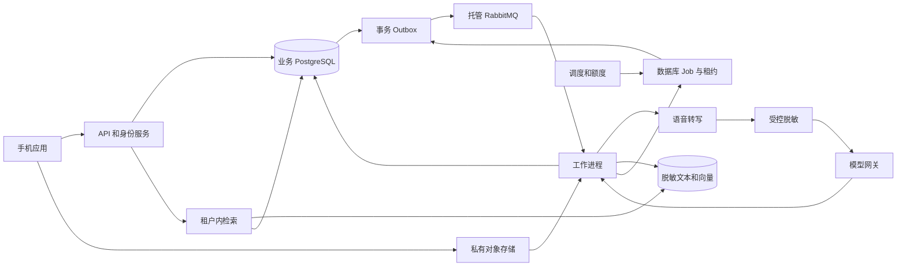

# 云端 Agent 详细设计总览与技术选型

本组文档将“保知伴 AI”保险销售人员个人助手的云端系统拆为可实现的模块。首发区域假设为中国大陆；一名销售人员是一个独立租户，个人客户资料不得跨租户共享。技术和容量为推荐方案，尚需样本评估、云厂商报价和安全审核。

## 文档索引

| 文档 | 设计范围 |
| --- | --- |
| [01 Agent 编排与模型网关](01_Agent编排与模型网关.md) | 记录处理、建议与问答工作流，模型路由、输入输出和容错 |
| [02 客户识别与事实更新](02_客户识别与事实更新.md) | 新老客户判断、人物消歧、事实版本和纠错撤销 |
| [03 数据库与持久化](03_数据库与持久化.md) | 表结构、约束、分片、事务和备份恢复 |
| [04 检索与客户记忆](04_检索与客户记忆.md) | 结构化、关键词和向量检索，以及带证据的 RAG |
| [05 异步任务与一致性](05_异步任务与一致性.md) | outbox、队列、调度、幂等、配额与事件恢复 |
| [06 安全与隐私](06_安全与隐私.md) | 录音链路、脱敏、信封加密、访问隔离和删除 |
| [07 部署与可用性](07_部署与可用性.md) | 部署拓扑、故障处理、观测、安全和演练 |
| [08 容量与成本](08_容量与成本.md) | 三阶段负载、公开模型单价、预算区间及压力情景 |
| [09 整体评审与修订清单](09_整体评审与修订清单.md) | 18 项问题、优先级、修订位置与上线验收 |
| [10 移动端交互与界面规范](10_移动端交互与界面规范.md) | 关键页面、异常状态、事实确认与隐私文案 |
| [11 产品开发计划](11_产品开发计划.md) | 20 周迭代、人员与 WBS、需求追踪、测试验收、发布及运维交接 |

## 总体工作流

对象存储保存加密录音；本地离线识别与云端受控识别是可选路径。采用托管 ASR 时服务商会接触原始音频，须满足第 06 文档的前置条件。模型和向量服务只接收通过安全策略的最小化文本。

## 明确的技术选型

| 层次 | 首选方案 | 选择原因和约束 |
| --- | --- | --- |
| 服务语言 | Python 3.12 | 与 ASR、NLP 和模型生态相容；生产镜像锁版本，跟踪安全更新 |
| API | FastAPI、Pydantic v2、Uvicorn | 统一参数校验、异步 I/O 和 OpenAPI；接口校验不替代权限校验 |
| 数据访问 | SQLAlchemy 2、asyncpg、Alembic | 事务与数据库迁移明确；每个并发任务独立使用 AsyncSession |
| Agent 运行 | 应用内有状态工作流及显式状态表 | 先覆盖确定的记录、分析和问答流程；不依赖模型自由规划或黑盒长期记忆 |
| 模型网关 | 独立 Python 模块与供应商适配器 | 统一安全检查、模型版本、限流、预算、统计和回退；网关不能绕过脱敏 |
| 语音 | 受控本地 ASR 优先评估；成本基准为备选百炼 paraformer-realtime-v2 | 托管 ASR 为原始音频处理方；仅在合同和授权符合条件时使用。基于 LLM 的语音模型不得接收未脱敏原音频 |
| 常规抽取与问答 | 百炼 qwen-flash-2025-07-28 非思考模式 | 作为可替换的试点基线，必须以中文保险语料评测；不默认使用联网和工具 |
| 较复杂建议 | 百炼 qwen-plus-2025-04-28 非思考模式 | 固定版本评测质量与价格；模型到期或效果不够时通过路由切换 |
| 向量模型 | 百炼 text-embedding-v4，768 维 | 输出只用于经脱敏的片段；维度、模型版本和语料版本共同管理 |
| 权威数据 | 云托管 PostgreSQL 16，高可用版 | 事务、关系、JSONB 与行级安全；实际小版本、插件与恢复能力以地域提供情况为准 |
| 检索 | PostgreSQL 索引、应用层中文分词、pgvector | 按租户过滤后精确计算；规模增长再评估单独托管向量服务 |
| 文件 | 加密的云 OSS | 录音和导出独立生命周期、版本和短期凭证；不以对象名暴露客户信息 |
| 事件队列 | 托管 RabbitMQ，AMQP 0-9-1，Python aio-pika | 发送确认、消费手动 ACK 和应用幂等；不承诺恰好一次 |
| 缓存与限流 | 托管 Redis | 缓存、分布式令牌桶；不作为客户事实、权益或任务状态的唯一存储 |
| 作业调度 | PostgreSQL 中的到期任务表与独立调度器 | 先用分片扫描和租约；不要每个客户配置一条云厂商定时器 |
| 加密密钥 | 云 KMS 与应用侧 AES-256-GCM 信封加密 | KMS 主密钥与业务数据密钥分离；KMS 规模和成本需独立估算 |
| 部署 | 两可用区 ECS、容器及托管中间件 | 试点采用 Docker 和 systemd；规模/团队要求成熟后再评估 Kubernetes |
| 监控及发布 | OpenTelemetry、云日志和指标、CI/CD、pytest、Ruff | 默认无客户原文；测试含越权、隐私、故障和回放 |

关联来源：[RDS PostgreSQL 的 pgvector 支持](https://help.aliyun.com/zh/rds/apsaradb-rds-for-postgresql/pgvector-use-guide/)；[托管 RabbitMQ 的 AMQP 0-9-1 支持](https://help.aliyun.com/zh/apsaramq-for-rabbitmq/)；[SQLAlchemy 会话并发约束](https://docs.sqlalchemy.org/en/20/orm/session_basics.html)。

模型 ID 是试点基准而非长期供应承诺。服务启动时检查实际地域、版本、许可、限流、接口、价格和可用性；发布配置记录模型快照与回滚版本。Python 依赖在生产锁定具体补丁版本，由持续集成检查依赖冲突和安全漏洞。

## 数据与责任边界

- 服务端从认证令牌解析 tenant_id；客户端传来的 tenant_id 不能决定归属。所有持久化主键、外键和查询都包含 tenant_id。
- 客户、事实、处理状态、任务和权益以 PostgreSQL 为权威；队列、缓存、向量和 Agent 输出均为可重试或可重建数据。
- 服务器生成 UUIDv4 作为客户和记录标识；随机 ID 不是授权凭证。离线客户端生成 client_record_id，服务端用租户加该 ID 保证重复提交不重复创建。
- 一个记录可以涉及多个客户，通过经过确认的片段级关系关联；模型只返回临时人物占位符，服务端负责归属和写入。
- 所有模型事实必须有来源记录、版本和证据片段；人工修改优先，用户更正或删除后旧版本任务不得复写。

## 记录状态和事件约定

记录状态改为相互独立的保存、处理、归属和确认状态：本地 local_only/uploading、服务端 stored/deleted；处理 queued/running/partial_success/succeeded/failed/blocked_quota/blocked_policy；客户归属 unassigned/ambiguous/linked；事实候选 proposed/confirmed/superseded/retracted。服务端保存不等待模型或人工确认，处理成功不等于归属已确认。API 返回各维度及失败阶段；UI 据此展示可恢复状态。

跨模块事件包含 event_id、event_type、schema_version、tenant_id、entity_id、entity_version、occurred_at、trace_id 和 producer；不包含姓名、电话、证件、原文、录音、向量或临时映射。事务提交事件见第 05 文档。删除通过版本增加、授权撤销与删除墓碑同时约束异步任务。

## 关键接口约定

| 接口 | 关键行为 |
| --- | --- |
| POST /v1/records/upload-sessions | 登录用户申请一次性上传；服务端校验套餐、音频类型和大小，签发短期对象凭证 |
| POST /v1/records | 使用 client_record_id 和对象摘要提交记录；仅在对象及数据库达到持久化条件后返回已保存 |
| GET /v1/records/{id} | 返回当前用户的处理状态、可见摘要、候选和可操作错误 |
| POST /v1/records/{id}/resolution | 确认单客户或片段关联；携带 expected_version 与 Idempotency-Key |
| GET /v1/customers/{id} | 返回有权限的客户资料、来源与版本；敏感信息按需授权解密 |
| POST /v1/customers/{id}/insights | 检查权益并预留额度，异步返回任务 ID；建议必须附证据 |
| POST /v1/assistant/questions | 校验用户权限和额度，仅检索本租户后生成回答 |
| POST /v1/privacy/deletions | 为用户自身或已核验的权利请求创建删除任务并返回进度 ID |

统一响应包含 request_id、状态、错误码与可重试标志。更新接口带版本或 If-Match；POST 幂等键按租户、操作类型、键值与请求摘要绑定，同键不同请求返回冲突。

## 分期和验收门槛

MVP 用模块化单体、独立工作进程和托管数据库；上线前完成租户隔离、DLP、删除、基本压测和法务审核。中期按队列、数据库及向量负载拆分；长期才根据压测进行有限分片或采用独立检索服务。所有方案均需先满足第三方模型的数据处理与容量限制。

完整背景见[保险销售 AI 助手需求与系统设计](../product/保险销售AI助手_需求与系统设计.md)。其中的价格和架构数值为上一轮占位估算，本组文档的成本模型使用单独列明的公开模型单价与基础设施假设，不应直接混算。

## 评审后统一约定

记录有 record_revision、对象有 entity_version、权限有 policy_epoch、任务领取有 fencing_token。每次调用外部模型前、输出提交前和向用户交付前检查所需的当前版本及权限。内容变更推进 revision；任务状态变化仅推进运行版本，避免进程自己的状态变更使其输入无故过期。

工作流是任务状态的唯一权威，RabbitMQ 只通知 job_id；首次创建任务、后续状态与 outbox 在同一数据库事务提交。定时器与消费者均走同一领取协议，不维护两套互相竞争的执行状态。

接口补充：GET /v1/sync/changes 返回授权范围内变化游标及墓碑；PATCH /v1/tasks/{id} 更新状态和联系结果；PATCH /v1/customers/{id}/contact-policy 更新勿扰；GET /v1/entitlements 返回有效期和计量；POST /v1/subscriptions/restore 校验渠道凭证；POST /v1/exports 创建需重认证的导出；POST /v1/sessions/{id}/revoke 撤销会话。所有写操作带版本、幂等键和服务端身份。

MVP 新增登录恢复、多设备同步、基础提醒、联系偏好、处理收件箱和分阶段计量。P1 增加多需求机会、授权导入、保单服务日期与批准的产品资料管理；不提前接入第三方聊天或自动外发。
