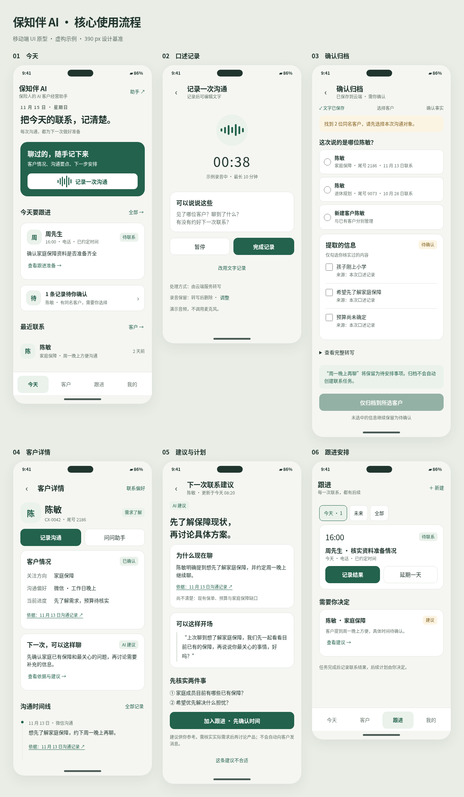
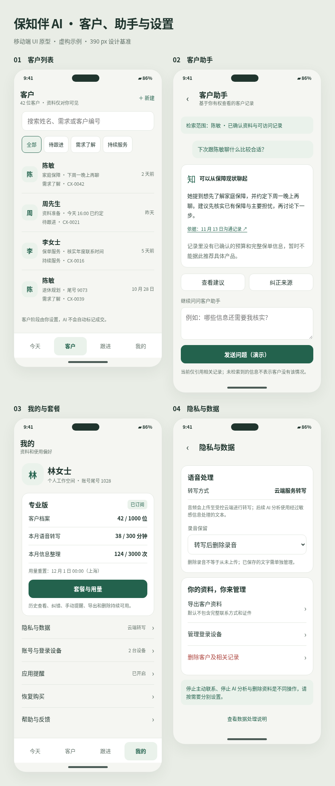

# 保知伴 AI 移动端交互与界面规范

产品工作名称为“保知伴 AI”，定位语为“保险人的 AI 客户经营助手”。名称经过公开网页初筛，尚未完成商标近似检索；示例内容均为虚构。视觉使用克制的深绿、浅纸色和清晰的层级，强调随手记录、每日跟进和可核对的事实。底部为今天、客户、跟进、我的四个入口；首页及客户详情始终有明显的记录动作。

## 页面及业务对应

| 页面 | 关键动作和信息 | 后台接口或状态 |
| --- | --- | --- |
| 今天 | 今日联系、待确认记录、快速录音、助手入口 | 任务摘要、记录收件箱、当前权益 |
| 口述记录 | 录音/暂停/完成或文字输入，保留草稿 | 本地保存、upload session、stored |
| 确认归档 | 同名候选、原文、逐项勾选事实、单独决定待办 | resolution、proposed 到 confirmed |
| 客户 | 搜索、阶段筛选、手动建档、最近联系 | 租户内列表和游标 |
| 客户详情 | 需求、联系偏好、证据时间线、建议和记录入口 | 客户事实、contact_policy、建议有效性 |
| 建议与计划 | 为什么建议、核实问题、修改时间后加入跟进 | suggestion 到用户确认的 task |
| 跟进 | 今日/未来、完成/延期、记录联系结果 | task 状态、task_outcome |
| 助手 | 显示检索范围、回答来源和不足的信息 | 权限检查、租户内检索与回答 |
| 我的与套餐 | 额度和重置日、恢复购买、可继续使用的功能 | entitlement、subscription restore |
| 隐私与数据 | 语音处理路径、保留期、设备、导出和删除 | policy、sessions、exports、deletions |

## 成功路径与异常路径

本地保存与云端保存使用不同文案。录音期间不显示伪造的云端实时转写；模拟原型用固定示例内容标识。结束后给出可编辑转写；仅在云端已接受后显示“已保存到云端”。无网络时保留加密草稿，重连后继续上传；用户可以继续文字记录。

同名客户的候选没有默认选中，用户可查看最近联系及脱敏辅助信息，选择现有客户或新建。确认客户不自动确认所有事实；默认仅勾选用户自己明确选择的条目。无法确定的语句保留为待确认，保存按钮明确说明保存的对象。

转写成功但分析失败时显示“文字已保存，信息整理暂未完成”，提供重试整理、编辑文字和稍后处理，不重新录音。额度用完时可查看和纠错历史资料、手动任务、导出、删除及保存本地草稿；不以升级挡住个人数据访问。

建议采纳后进入任务编辑，用户选择具体日期、时间和渠道；创建后不会自动联系客户。完成任务需选择已联系、未接通或其他结果，可补记口述，后续计划由用户再确认。推送关闭时提醒保留在应用内，并提供去设置的入口。

## 事实和隐私文案

用户确认事实显示“已确认”，模型抽取显示“待确认”，建议显示“AI 建议”。每个依据都可打开对应记录和证据片段；用户更正后页面提示相关建议需要更新，不能保留过期建议的采纳按钮。

客户联系偏好使用“正常跟进”“暂停联系”“不再主动联系”。暂停后停止新的主动经营建议和提醒，客户档案仍可访问；删除与撤回处理依据是独立操作。删除先展示具体范围、清理时限和备份处理说明，最终提交后只显示进度，不提供与后台删除相矛盾的撤销。

在我的页面同时呈现“由云端服务转写”和“转写后删除录音/保留 7 天”；不使用“永不上传”“完全匿名”“绝对安全”等无法满足的承诺。语音权限只在用户点击录音时申请，拒绝后仍可输入文字。

## 交互和无障碍约定

最小触控目标 44 × 44 逻辑像素；正文建议 15 至 17，辅助信息至少 12，避免只用颜色表达待确认或失败。支持大字模式、深浅色、屏幕阅读器和键盘焦点；对重要动作使用有文字的按钮。输入字段配 label，错误与原输入同屏保留，弹出确认后焦点可回原位置。

原型以 390 逻辑像素展示，同时验证 320、390、736 宽度；真实开发需额外测试 iOS 安全区域、Android 返回手势、键盘遮挡、来电/音频中断、耳机切换、锁屏、磁盘不足及系统杀进程。录音 SDK 用平台能力，不承诺后台无限录音。

## 原型交付和覆盖边界

原型包含可切换的页面与场景、可点击的主路径和静态总览图，使用固定虚构样本；不接麦克风、账户、云服务、消息和支付。确认、暂停和任务操作仅改变演示状态。真实账号恢复、支付渠道和设备设置以界面说明占位，不将其说成已经实现。

文档修订完成不等于 APP 验收通过。实施时用 F13 至 F20 与评审 R01 至 R18 作为测试追踪项，逐项验证页面状态与真实 API 一致。

## 页面总览图

## 原型验证范围

本地 Chromium 已验证口述、暂停、同名选择、逐项确认、归档、创建跟进及记录结果；拒绝联系后阻止采纳主动经营建议，更正来源后旧建议失效。离线、权限拒绝、额度用尽、部分成功、删除确认和客户搜索路径已检查。10 个主页面在 320、390、736 宽度下无横向溢出，并检查了深色首页。原型使用固定虚构样本，不接真实麦克风、支付、消息、账号或云服务；正式 iOS 与 Android 设备体验仍需联调验证。

[在线交互原型与界面规范](10_移动端交互与界面规范.md)。本地验证入口为 `../../design/prototype/验证与截图.py`，结果保存在 `验证结果.json`。

## 产品命名与公开检索

工作名称采用“保知伴 AI”，定位语为“保险人的 AI 客户经营助手”，传播语为“把每次沟通，变成下一步”。“保”体现保险业务，“知”表达记住客户信息、理解沟通与需求，“伴”表达销售人员的个人专属助手；AI 明确产品的智能能力定位。

原工作名“知客”已有多个相近领域的产品使用，因此不继续采用，也不简单加上 AI 后缀。

| 已有名称 | 可核实的产品用途 | 公开来源 |
| --- | --- | --- |
| 知客 CRM | 客户关系、销售过程和运营分析软件 | [官方企业介绍](https://www.zkcrm.com/about.html) |
| 知客 AI | AI 智能客服、微信客服及网站咨询 | [产品官网](https://www.zhike.chat/index.html) |
| 知客 | 道序销售智能体，包含客户分析、沟通策略与复盘 | [官方产品页](https://www.daoxu.com.cn/products/zhike.html) |
| 知客 App | 面向商家的移动办公与店铺管理 | [Apple App Store](https://apps.apple.com/cn/app/%E7%9F%A5%E5%AE%A2/id1455484609) |

2026 年 11 月 15 日公开网页检索了“保知伴”“保知伴 AI”“保知伴AI”“保知伴 商标”“保知伴 公司 产品”、Apple App Store 域内结果，以及近音“保智伴”和拼音 Baozhiban。此次未发现明确使用“保知伴”作为名称的同类品牌、产品官网或应用条目；检索“保智伴”出现了“巡检维保智伴”等其他领域组合用语，不能据此认定不存在近似名称。

以上是公开网页初筛，不代表商标可注册、域名可用或已取得应用商店名称。正式启用前仍需完成商标同名及近似检索，并核对拟使用的域名与渠道名称。
