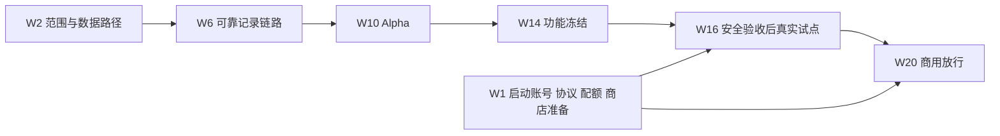

# 保知伴 AI 产品开发计划

版本：V1.0 规划基线；编制日期：2026-11-15。适用范围：中国大陆个人保险销售人员使用的 iOS、Android APP 与云端 AI Agent。当前已有需求、详细设计和交互原型，尚未完成生产软件开发。

**建议用 20 个有效工作周交付首个受控商用版本：7 名全职成员，加平均 1.5 个全职当量的兼职支持，采用两周一次迭代和六个阶段评审。** 工作分解初估为 513 个有效人日；团队有效产能为 637.5 人日，保留 124.5 人日用于缺陷、技术风险和试点修订。此为待实际团队校准的计划，不是已经批准的人员、预算或上线日期。

计划以[产品需求](../product/保险销售AI助手_需求与系统设计.md)、[架构与详细设计](00_设计总览与技术选型.md)、[18 项评审问题](09_整体评审与修订清单.md)和[移动端原型](10_移动端交互与界面规范.md)为输入。本计划替代需求文档中最初的 16 周排期；需求范围以本计划的版本分配和追踪矩阵明确。

## 1. 工程方法与标准依据

采用“迭代交付 + 风险驱动验证 + 阶段放行”。每次迭代都包含设计、开发、测试和演示；隐私、安全、AI 评测与运维从第一阶段介入。

| 参考依据 | 本项目的工程落地 |
| --- | --- |
| [ISO/IEC/IEEE 12207:2026，软件生命周期过程](https://www.iso.org/standard/90219.html) | 覆盖立项、需求、设计、实现、集成验证、交付、运行维护及退出；明确责任、输入、输出与评审记录 |
| [ISO/IEC/IEEE 29148:2018，需求工程](https://www.iso.org/standard/72089.html) | 建立需求基线、可验证验收条件、双向追踪、优先级与变更控制 |
| [ISO/IEC 25010:2023，产品质量模型](https://www.iso.org/standard/78176.html) | 将性能、可靠性、安全性、交互及维护等质量要求转换为可测指标和测试方案 |
| [NIST SP 800-218，SSDF 1.1](https://csrc.nist.gov/pubs/sp/800/218/final) | 将威胁分析、依赖管理、代码审查、安全验证、发布保护和漏洞响应纳入研发流程 |

依据上述标准的公开说明制定项目实践，不宣称已完成逐条符合性审计或认证。本文排期、人数和数值门槛是项目规划，不是标准规定。

## 2. 范围、版本与启动假设

| 版本 | 时间 | 必须具备的能力 | 使用边界 |
| --- | --- | --- | --- |
| Alpha 0.1 | W10 | 记录保存、转写脱敏、客户候选与事实分别确认、档案与来源、纠错、基础任务的纵向闭环 | 内部合成数据测试；不能称为全部 P0 已完成 |
| RC 0.9 | W16 | 全部首发 P0；有证据的问答与经营建议、预算调度、订阅及异常处理；通过安全、性能和恢复测试 | G4 放行后才能接入真实客户资料开展封闭试点 |
| 商用 1.0 | W20 | 试点问题关闭、双端发布、购买恢复与退款对账、服务支持和运维交接完成 | G5 放行后分批开启收费，首批建议 10–50 名自愿付费用户 |
| 后续版本 | 另行立项 | 多需求机会、授权保单服务日期、经批准的产品知识库、团队功能及规模化改造 | 不挤占 1.0 的可靠性和隐私工作 |

首发完整路径：口述或文字记录 → 可靠保存 → 脱敏提取 → 确认客户及事实 → 客户档案 → 生成建议或手动建任务 → 人工联系 → 记录结果。基础手动任务、提醒、纠错、历史资料访问、导出和删除不因付费到期而停用。

首发默认关闭“未预选客户的自动关联”，由候选推荐与人工确认完成归档；只有达到独立质量门槛后才另行开启。关联记录与确认事实始终是两项操作。建议仅包含基于证据的沟通话题、核实问题和下一步，不接入自动外发消息、投保交易、核保判断或无依据的具体产品推荐。

排期假定核心团队已有移动端、事务系统和 AI 服务交付经验；移动端采用一套跨平台代码库，Flutter 与 React Native 在 W2 前经录音、后台限制和离线加密验证后选定。团队、开发者账号、试验预算与合成数据环境就绪时才开始 W1。按每周 5 个工作日估算，节假日另排；供应商协议、资质和应用商店审核尽早启动，另预留 2–4 个日历周的外部依赖风险窗口，不视为审核时限承诺。

## 3. 团队、工作量和责任

人日均为 8 小时的有效工作量。计划按 75% 可投入产能计算，余下时间覆盖会议、协作、休假等日常开销；工作包已包含相应设计、代码审查和正常测试，不以“只算编码”估工。

| 角色 | 平均投入 FTE | 20 周有效产能 | 已分配有效人日 | 主要责任 |
| --- | --- | --- | --- | --- |
| 产品／交付负责人 PM | 1 | 75 | 55 | 需求、范围、排期、验收组织与试点 |
| 技术负责人兼后端 + 后端工程师 | 2 | 150 | 120 | 架构、数据、API、任务一致性、权益与交付 |
| 移动端工程师 | 2 | 150 | 134 | 共享业务界面及 iOS、Android 原生集成 |
| AI 工程师 | 1 | 75 | 60 | ASR、脱敏、提取、检索、评测及模型成本 |
| 测试工程师 QA | 1 | 75 | 62 | 测试策略、自动化、集成验证和质量报告 |
| 运维／平台 SRE | 0.5 | 37.5 | 28 | 环境、CI/CD、观测、备份、灾备和值班 |
| 交互与视觉 UX | 0.5 | 37.5 | 24 | 原型深化、异常状态、可用性与无障碍检查 |
| 安全与法律支持 | 0.2 | 15 | 12 | 数据路径、供应商条款、威胁分析和安全评审 |
| 保险业务与试点运营 | 0.3 | 22.5 | 18 | 场景标注、业务验收、招募、支持和培训 |
| **合计** | **8.5** | **637.5** | **513** | **7 名全职，兼职合计 1.5 FTE** |

总投入上限为 8.5 × 20 × 5 = 850 个名义人日；有效产能为 850 × 75% = 637.5 人日；风险余量 124.5 人日占有效产能约 19.5%。FTE 是平均投入，不是自然人数。UX 在前四周优先集中投入；SRE、安全和业务在评审及演练周集中投入，整体平均额度不变。

已核对角色总产能，但这不等于每周资源已完成排平。W2 必须按实际人员和请假计划完成逐 Sprint 负载校准；任何角色超载先调顺序和范围，不能用其他角色的空余代替专业能力。初估允许约 ±30% 波动，超过余量或影响关键路径时重新确定基线。

项目发起人负责投资与商业放行，PM 对范围和交付计划负责，技术负责人对技术方案负责，QA 对测试证据负责，安全负责人对数据路径及安全门槛负责。G4、G5 由 PM 组织技术、QA、安全和业务共同评审；未关闭的重大安全、数据丢失或计费问题不能由单个角色豁免。

## 4. 20 周迭代路线

W 表示相对工作周；S 表示两周一次的 Sprint。各工作包先定义接口再并行实现，每个 Sprint 必须演示一个可验证的增量。

| 迭代 | 周期 | 主要工作与可演示结果 | 阶段出口 |
| --- | --- | --- | --- |
| S1 | W1–2 | 访谈 10–20 名销售人员；需求和数据流基线；移动端与 ASR 技术验证；测试样本规则；建立代码库及流水线 | G0：范围、数据处理路径、接口原则与资源基线可执行 |
| S2 | W3–4 | 登录与租户骨架、加密和迁移；双端记录／文字草稿；上传及持久化协议；任务账本和 Outbox | 演示“离线草稿 → 云端已保存”，可区分保存与处理状态 |
| S3 | W5–6 | 受控 ASR、脱敏与模型网关；重试、限流和阶段计量；原生录音中断／后台限制；观测 | G1：合成语音贯通，断网、重复提交和模型失败不丢记录 |
| S4 | W7–8 | 人物候选、同名及多人消歧；事实逐项确认；来源与修订版本；档案和时间线 | 人工更正后旧任务不能复写；证据可定位 |
| S5 | W9–10 | 纠错撤销、基础检索与历史回退、手动任务；推进同步、删除和权益模块 | G2：Alpha 闭环通过内部验收，继续使用合成数据 |
| S6 | W11–12 | 多设备冲突／恢复、导出与删除；提醒、勿扰与权限兜底；问答、建议与订阅沙箱联调 | 演示冲突、撤回、拒绝通知、退款及部分成功异常 |
| S7 | W13–14 | 预算调度、证据失效传播、支付乱序／购买恢复；端到端联调和功能冻结 | G3：首发功能范围完成，测试与文档齐备；仅修复和收敛 |
| S8 | W15–16 | 真机回归、安全与 AI 评测、容量与 72 小时稳定性测试、单区及跨区域恢复；商店资料准备 | G4：RC 放行；全部首发 P0 和商用基线通过，才允许真实资料试点 |
| S9 | W17–18 | 约 50 名自愿用户封闭试点，授予试用权益；观察确认负担、错误、成本和支持请求；提交商店审核 | 试点问题按严重程度修复，不能以样本少推断长期指标 |
| S10 | W19–20 | 达标后扩大到约 100 名试点用户；回归、账单对账、培训、值班和运行交接 | G5：商用评审；审核及门槛通过后开启小批量收费 |

20 周交付是试点级商用能力，验证基线采用 500 个付费账户与 2000 个免费账户的负载假设；不等于承诺此时已经获客到该规模，也不等于已验证 5 万付费用户的生产容量。

## 5. 工作分解结构 WBS

以下是 Epic／工作包级估算。负责人是责任角色，启动时再落实到具体人员。W1–W20 是可开展工作的窗口，不表示整个窗口内持续占满人力。“契约”依赖表示前序接口、状态或数据设计评审通过即可并行，不要求等待该工作包全部完成。

| 编号 | 工作包与交付 | 工作窗口 | 前置依赖 | 责任角色 | 人日 |
| --- | --- | --- | --- | --- | --- |
| WP01 | 需求基线、业务场景、原型深化、数据路径、ADR、试点及验收方案 | W1–4，后续受控细化 | 启动条件 | PM | 56 |
| WP02 | 代码库、CI/CD、环境隔离、基础设施代码、监控和发布骨架 | W1–6 | WP01 的环境与权限原则 | 技术负责人／SRE | 30 |
| WP03 | 登录、租户隔离、会话、密钥、数据模型、迁移和基础权益 | W3–8 | WP01 G0；WP02 环境 | 后端 | 42 |
| WP04 | 双端录音／文字、离线加密、上传、受控 ASR／DLP、Job／Outbox、状态及恢复 | W3–10 | WP02；WP03 身份、上传与存储契约 | 移动端／后端 | 67 |
| WP05 | 候选识别、多人消歧、事实确认、版本、证据关系及重跑 | W5–12 | WP04 转写、脱敏及状态契约 | AI／后端 | 62 |
| WP06 | 档案、时间线、检索与历史回退、纠错撤销、多设备冲突和来源展示 | W5–14 | WP03 数据契约；WP05 证据与版本契约 | 后端／移动端 | 51 |
| WP07 | 免费手动任务、提醒、通知兜底、联系偏好、勿扰及结果闭环 | W7–14 | WP03 权益；WP05 任务候选契约 | 后端／移动端 | 36 |
| WP08 | 数据导出、重认证、删除传播与墓碑、账号恢复、审计及客服脱敏诊断 | W5–14 | WP03 权限；WP04–06 数据生命周期契约 | 后端／安全 | 40 |
| WP09 | 带来源的问答、建议、事件合并、预算调度、模型评测及降级 | W7–14 | WP04 网关；WP05–06 有效证据检索；WP07 联系策略 | AI | 44 |
| WP10 | 订阅、计量预留和阶段结算、购买恢复、退款／乱序、降级与对账 | W5–14 | WP03 权益；WP04 阶段计量契约；渠道资质 | 后端／移动端 | 29 |
| WP11 | 系统回归、渗透与 AI 对抗、性能、故障注入、区域恢复及回滚演练 | W9–16 | 逐步接入 WP03–10；完整验收依赖 G3 | QA／SRE | 29 |
| WP12 | 用户试点、商店材料与审核、成本复核、培训、支持和值班交接 | W1 启动外部依赖；W15–20 集中交付 | 真实资料须 G4；收费须 G5 | PM／业务 | 27 |
| **合计** | **工作包内含正常测试与评审；WP11 是系统级增量验证** | | | | **513** |

关键路径是数据处理路径与移动端验证 → 身份及可靠存储 → 转写与脱敏 → 事实和来源闭环 → 删除、安全与系统验证 → 真实试点 → 双端审核与商用放行。商店账号、供应商协议和模型配额从 W1 并行推进，任何一项延误都可能改变最终上线日期。

## 6. 需求与验收追踪

追踪方向为需求／问题 → 工作包 → 实现及配置 → 测试用例 → 报告 → 发布版本。以下表格给出初始覆盖；执行时必须补具体 Story、PR、用例和报告链接。当前所有实现状态均为“待启动”，设计文件已经修订不计作研发完成。

| 需求 | 1.0 的处理 | 工作包 | 验收重点与最迟门槛 |
| --- | --- | --- | --- |
| F01 | 首发 P0 | WP03、WP08 | 隔离、登录、会话及注销；G4 |
| F02 | 首发 P0 | WP04 | 双端中断、弱网、加密草稿、幂等；G4 |
| F03 | 首发 P0 | WP04、WP05 | 修订后重跑、失败阶段和重试；G4 |
| F04 | 首发 P0，默认人工确认 | WP05 | 同名、多人、不确定不静默写入；G4 |
| F05 | 首发 P0 | WP05、WP06 | 唯一编号、档案、字段和证据；G4 |
| F06 | 首发 P0 | WP06、WP07 | 时间线与待确认任务、延期／取消；G4 |
| F07 | 基础搜索 P0；首发纳入问答 P1 | WP06、WP09 | 租户内召回、有效证据、资料不足；G4 |
| F08 | 首发 P0 | WP05、WP06 | 误关联撤销及派生数据修正；G4 |
| F09 | 首发纳入经营建议 P1 | WP09 | 有来源、可编辑、预算内调度；G4 |
| F10 | 基础权益 P0；首发纳入订阅 P1 | WP03、WP10 | 服务端额度、剩余量、周期、升级；G4，商用对账 G5 |
| F11 | 首发 P0 | WP07 | 免费提醒、时区、静默时段、拒绝通知；G4 |
| F12 | 首发 P0 | WP08 | 导出、客户删除、账号注销、状态；G4 |
| F13 | 首发 P0 | WP01、WP04 | 按需申请麦克风、拒绝后的文字路径；G4 |
| F14 | 首发 P0 | WP04、WP05 | 保存／处理／归属／确认独立呈现；G4 |
| F15 | 首发 P0 | WP07 | 联系结果与任务状态分开，免费可用；G4 |
| F16 | 首发 P0 | WP07、WP09 | 勿扰四处检查，撤回处理依据独立；G4 |
| F17 | 多机会及保单服务日期延期 | WP01 后续 Backlog | 不进入 1.0 承诺；基础联系结果由 F15 覆盖 |
| F18 | 首发 P0 | WP03、WP06、WP08 | 设备撤销、恢复核验、409、墓碑优先；G4 |
| F19 | 首发 P0 | WP10 | 购买恢复、退款、降级、额度周期；G4／G5 |
| F20 | 首发 P0 | WP06、WP08、WP09 | 原文依据、纠正、最小诊断反馈；G4 |

| 评审项 | 工作包 | 发布处理 |
| --- | --- | --- |
| R01 | WP04 | G4：四类状态及部分成功可恢复 |
| R02 | WP05 | G4：归属确认不能代替逐项事实确认 |
| R03 | WP07、WP09 | G4：筛选、执行、展示、通知均校验勿扰 |
| R04 | WP04 | G4：数据库 Job 权威、租约、fencing、Outbox 与幂等 |
| R05 | WP06、WP09 | G4：每条来源的 revision 独立校验 |
| R06 | WP05、WP06、WP09 | G4：多来源关系与失效传播 |
| R07 | WP04、WP10 | G4：已交付阶段结算、失败阶段释放、重试不重复扣 |
| R08 | WP03、WP06、WP08 | G4：同步冲突、恢复和离线删除 |
| R09 | WP07 | G4：免费提醒、通知拒绝与应用内兜底 |
| R10 | WP08 | G4：导出重认证、下载时再鉴权、字段最小化 |
| R11 | WP06 | 首发纳入：历史关键词及结构化回退，G4 |
| R12 | WP07；后续功能 | 首发交付 task_outcome；多机会和保单服务日期另排 |
| R13 | WP09；后续功能 | 首发限制为核实问题与经营话题；产品知识版本管理另排 |
| R14 | WP08、WP11 | G4：恢复前验证最新删除墓碑水位 |
| R15 | WP10、WP12 | G5：平均使用与套餐满额成本分别核算 |
| R16 | WP01、WP11 | G0 确定 ASR 路径；自建则单列资源和费用，G4 复核 |
| R17 | WP01、WP04 | 首发纳入：明确“不保留音频”仍可能上传，G4 |
| R18 | WP02、WP03、WP04、WP08 | G4：上传／短信／会话限额、日志留存及凭证保护 |

## 7. 阶段放行条件和证据

G0–G5 都要留存版本、评审日期、参与角色、结论、遗留项、负责人和到期日。门槛未通过则修复、重新验证并调整计划，不用日历日期替代验收。

| 门槛 | 必交证据 | 通过后允许的动作 |
| --- | --- | --- |
| G0／W2 | 首发需求与数据字典、数据流和威胁模型、ASR／模型可行性、原生能力验证、供应商及账号依赖清单、人员预算基线、评测与测试方案 | 按冻结接口开展实现；继续使用合成数据。协议和处理依据未完成，不得接入真实样本 |
| G1／W6 | 记录持久化和重试演示、租户隔离测试、ASR／DLP 初评、阶段状态及计量日志、CI 与回滚骨架 | 进入全业务闭环集成 |
| G2／W10 | Alpha 演示包、核心场景用例与结果、缺陷清单、首轮可用性报告、剩余工作量修订 | 内部扩大验证；尚不允许真实客户资料试点 |
| G3／W14 | 首发范围逐条实现清单、接口与迁移冻结、所有 P0 和纳入首发 P1 的测试用例、完整系统测试入口 | 冻结新功能，集中进行质量收敛 |
| G4／W16 | 全部首发 P0 与商用基础功能通过；严重缺陷清零；数据处理依据和供应商路径就绪；DLP／AI、隔离、删除、安全、真机、性能、单区及区域恢复报告；值班及应急可执行 | 招募用户接入真实资料封闭试点，提供试用权益 |
| G5／W20 | 试点反馈关闭或明确接受的轻微问题；支付与退款对账、成本及套餐批准；双端上架渠道可用；培训／支持、监控与发布回滚演练完成；技术、QA、安全、产品及业务签署记录 | 小批量收费上线，达到运行观察条件后再逐批扩大 |

“严重缺陷清零”指 S0（越权、敏感信息泄露、删除复活、已确认数据丢失、重复收费等）和 S1（主要流程不可用、无法规避的错误归档等）均为 0；需求优先级 P0 与缺陷严重程度 S0/S1 分开使用。一般界面问题可以有记录地延期，数据、安全和计费阻断项不能以“已知问题”放行。

## 8. 可测质量指标

下列指标与第 07 份部署设计对齐。新增 AI 数值是建议的项目验收线，W2 根据基准样本确定后纳入配置管理；不得事后为通过验收而只调整样本或分母。

| 编号 | 指标与测量口径 | 验证方法及负责人 |
| --- | --- | --- |
| NFR01 | 核心登录、客户／记录读写月度可用性 99.9%；供应商故障同时纳入端到端体验统计 | QA＋SRE；发布前稳定性与故障测试，发布后以真实月度数据验证。72 小时测试不能证明月度 SLA |
| NFR02 | 正常大小记录上传结束至持久化确认 P95 < 3 秒 | QA＋后端；单独标记上传结束及事务／对象持久化时间，不把排队算作已保存 |
| NFR03 | 90 秒音频上传成功后，至少 95% 在 5 分钟内成功完成转写与提取，包含排队和供应商耗时 | AI＋QA；失败列入未达标部分，并另报失败率，不能从分母删去失败任务 |
| NFR04 | 约定数据量及并发下租户内常用搜索服务端 P95 < 500 毫秒，不含生成时间 | 后端＋QA；空库、小租户及 1000 客户租户、冷热历史分层验证 |
| NFR05 | 符合权益、授权和预算条件的定期建议任务，至少 95% 在到期后 24 小时内成功交付 | AI＋SRE；记录到期、阻断、失败及交付状态；显示失败不计成功，纳入资格和取消规则固定 |
| NFR06 | 接受删除后立即禁止读取及新处理；在线物理清理目标 72 小时内，备份按最长 30 天生命周期淘汰 | 安全＋QA；权威库、对象、索引、缓存、队列、第三方及恢复链路均有证据，受限留存按既定政策处理 |
| NFR07 | 单区故障有切换；区域恢复目标 RPO ≤ 15 分钟、RTO ≤ 4 小时 | SRE＋QA；数据库、对象、密钥可用性与最新删除墓碑共同演练，单纯双可用区部署不能视为区域达标 |
| NFR08 | 无跨租户访问；旧任务不得覆盖更正或删除；同一计量事件不得重复扣减 | 后端＋安全＋QA；并发、重试、乱序、故障恢复和恶意请求验证，任何反例阻断发布 |
| AI01 | 普通话清晰口述建议 CER ≤ 10%；抽取字段精确率 ≥ 98%、召回率 ≥ 90%；证据引用有效率 ≥ 99% | AI＋业务＋QA；独立留出至少 1000 条代表性记录，口音、噪声、多人分别报告；核心人名／日期／数字单列，不能用平均值掩盖 |
| AI02 | 直接标识符脱敏按类型报告召回；单侧 95% 置信下限目标 ≥ 99.9% | 安全＋AI；约 3000 个独立阳性样本且零漏检才可能达到该统计线，逐类型验证，相关或重复模板不当作独立证据；同时报告误报和样本局限 |
| AI03 | 无越权引用、删除后引用、无依据产品承诺；提示注入不能改权限、调用非授权工具 | 安全＋业务＋QA；固定对抗集加人工抽查，严重反例为阻断项 |
| UX01 | 10–20 名目标用户中至少 90% 能无需指导完成“记录—确认—找到档案”，错误能恢复 | PM＋UX；iOS／Android 真机观察，单列拒绝权限、大字、屏幕阅读与弱网场景 |

AI01 的准确率属于样本集指标，报告必须包含样本构成、计数、置信区间和失败案例。ASR 和 DLP 评测集与提示词调优集隔离；未经真实数据准入评审，使用合成或已合法取得且严格受控的样本。测试集不足不记为通过。

AI02 未通过时关闭受影响的外部 LLM／embedding 路径，保留记录和人工路径；这属于降级，不自动算作 1.0 全部 AI 范围完成。未预选客户的自动关联另按原需求 99.9% 精确率及其置信下限门槛放行，不作为默认功能上线。

区域灾备的采购、复制、密钥和演练预算必须在 G0 单列。若无法达到 NFR07，不可把双可用区描述成已达标；应保留内部验证并由项目负责人重新批准发布范围、可靠性目标和用户承诺，再重定计划。

## 9. 测试与 AI 评测执行计划

| 层级 | 持续执行内容 | 最迟形成证据 |
| --- | --- | --- |
| 单元与领域不变量 | 状态转移、事实版本、租户边界、删除策略、权益预留／结算、时区及勿扰规则 | 每个相关 PR；关注风险分支，不靠全局覆盖率代替正确性 |
| 契约与集成 | OpenAPI、事件版本、数据库约束、ASR／LLM 限流／超时、对象过期、支付签名与乱序 | 从 S2 开始，G3 完整 |
| 双端端到端 | 麦克风拒绝、录音中断、锁屏、离线加密草稿、续传、同步 409、退出／换机、购买恢复 | 每 Sprint 主流程；G4 完整真机矩阵 |
| 安全与隐私 | API／对象／索引／队列越权、敏感日志、导出链接、SDK 数据路径、删除后恢复、提示注入 | 威胁模型 W2；持续扫描；G4 完成独立复核 |
| AI 回归 | 固定留出集、分层指标、证据和幻觉、退化对比、模型／提示词／脱敏版本记录 | W2 方案；每次相关变更；G4 发布评测包 |
| 性能与故障 | 排队及配额、热点租户、数据库增长、任务重放、单区故障、跨区域恢复、72 小时稳定运行 | G4；关键修订后针对性复测 |
| 用户验收 | 有代表性的销售工作流、数据权利、纠错负担、提醒及建议价值、支持可理解性 | G2 合成场景；G5 真实试点 |

真机矩阵在 W2 固定支持的最低系统版本、最近两个主要系统版本、典型屏幕尺寸及低内存机型；至少覆盖两类 iPhone 与三类主流 Android 厂商设备。录音后台行为以操作系统实际限制设计，不能承诺所有锁屏、来电或强杀场景持续录制。

首发负载数据基线：500 付费 × 600 客户 + 2000 免费 × 50 客户 = 40 万客户，热向量上限示例为 160 万条；按既有使用假设日均 2000 条记录，最忙时段约 7 条／分钟。系统测试覆盖此数据量、持续负载及 2 倍峰值；业务 API 暂用 50 并发会话、20 RPS、读写 8:2 作为工程占位，W2 按实际调用链校准。双倍负载至少运行 1 小时，正常基线进行 72 小时稳定性观察。

大规模压测可模拟模型响应以验证队列和数据库，但必须另用真实账号与获准数据验证 ASR／LLM 的端到端时延、配额、失败和实际账单。不能把 mock 压测结果当作供应商能力证明。

## 10. 配置、代码与变更管理

建议同一代码库管理 mobile、api、workers、contracts、infra、evals 和 docs；实际目录在启动时确定。API 用 OpenAPI，事件有 schema_version，数据库迁移受版本控制。开发、测试、预发布、生产隔离，非生产环境默认使用合成数据；生产凭证由密钥管理系统注入。

每项任务进入 Sprint 前须满足 DoR：有需求编号、责任人、输入输出与异常状态、验收用例、数据敏感等级、依赖和估算；实现子任务通常拆到 1–3 人日。必要的技术探索单列时间盒和结论，不能无限期挂在功能任务下。

每项功能完成须满足 DoD：代码评审通过、相关单元／集成／真机或 AI 回归通过、无新增阻断风险、接口及迁移文档更新、监控与敏感日志检查通过、开关／降级／回滚可执行、验收证据链接完整。未通过测试的功能不计入已完成。

主分支受保护，短期分支合并至少一名非作者审核；认证、隐私、计费和数据迁移由技术负责人及相应专业角色复核。CI 包含格式、静态检查、必要测试、依赖漏洞与密钥扫描；版本发布保留依赖锁定、SBOM、构建摘要和签名／来源记录。发布清单同时锁定 APP、API、数据库、模型、提示词、DLP 规则及评测数据版本。

采用向前兼容的数据库扩展／收缩迁移；APP 与服务端支持窗口在 W2 确定，至少兼容当前正式版与上一正式版。删除后的数据不得因应用回滚或旧备份恢复而复活；移动端商店版本不能保证即时撤回，要有服务端开关和兼容接口。

每两周计划、演示和复盘，每周检查进度、风险、成本及依赖。新增范围超过 5 个有效人日、关键路径延后 1 周、人员或供应商路径发生变化时，由 PM 组织重新估算并更新基线。变更记录写清原因、需求、成本、周期、质量和安全影响及决定；风险余量不用于自动接收新功能。

## 11. 发布、运行与维护

发布顺序为开发 → 测试 → 预发布 → 内部合成数据验证 → G4 后真实资料试点 → G5 后小批量收费。每批扩量前观察至少 48 小时的核心成功率、错误归档、积压、退款与成本；高影响事件立即停扩。初期容量上限按实测结果控制，不因获客需求跳过扩容验证。

发布包包含发布说明、迁移脚本、配置与模型版本、已知轻微问题、验收报告、回滚步骤、负责人和联系顺序。服务端先进行兼容性部署，再逐步开启功能；不可逆迁移和删除任务单独核验。正式发布、支付开关和真实用户通知由授权的项目角色执行，本计划不代表这些动作已发生。

运行熔断基线：发现一次跨租户访问、敏感数据违规外发、删除复活、已确认记录丢失或重复收费，立即关闭受影响功能并响应；核心有效请求错误率连续 5 分钟超过 1% 时暂停扩量并调查或回滚。排队时延逼近转写目标时，先暂停低优先级深度分析，保护记录保存和基础读取。阈值及值班职责在 G4 演练后冻结。

必须交接监控面板、告警订阅、工单和事件流程、供应商配额、密钥与证书更新、备份检查、账单对账、数据权利请求及漏洞响应手册。商业开放前明确轮值第一响应人、备份人员及覆盖时段；兼职 SRE 不等于自然具备全天候运维能力，额外覆盖需在预算中落实。

上线后每月检查漏洞、供应商／模型生命周期、配额和死信恢复，每季度演练单区切换、区域恢复和删除重放；每次变更关键组件后进行针对性验证。保留停止服务方案：提前通知、停止续费／妥善处理剩余权益、提供导出、按政策清理数据、撤销供应商凭证并保存必要的处理证据。

## 12. 成本、采购与商业门槛

研发预算分开计算，避免把模型调用费当作项目总成本：人员预算 = 各角色名义投入人日 × 该角色实际含管理成本日费率；再加开发／预发布云资源、AI 评测、短信推送、测试设备、开发者账号、商店／支付费用、安全与法律支持等非重复支出。7 名全职加兼职支持的 20 周计划上限为 850 名义人日；不能用 513 个有效人日直接当作全部工资成本。

外部等待若导致全团队额外保留 2–4 周，约增加 85–170 个名义人日；实际可通过提前安排采购和调整人员投入减少。G0 由项目发起人批准金额上限及采购清单，G2 根据实耗和剩余工作量更新完工成本预测。

生产运营费用沿用[容量与成本详细设计](08_容量与成本.md)的三档模型，采购前重新询价。现有试点约 1.33–4.52 万元／月仅是既定负载及初步双可用区资源的规划区间，不能直接覆盖跨区域恢复承诺、人员、税费、渠道分成和全部审计成本；自建 ASR 另算算力与运维。

G5 必须同时审阅平均用量、套餐全部用满和供应商价格上升三种情景，补入失败重试、KMS、存储、跨区复制和客服成本后确定售价及毛利底线。当前免费 100 客户、付费 1000 客户等额度仍是试点假设。AI 预算达到 80% 告警、100% 暂停可延期分析；不得静默扣费、删除档案或中断基础数据权利功能。

## 13. 主要风险及应对

| 风险与触发信号 | 责任角色 | 预防及处理 |
| --- | --- | --- |
| ASR／SDK 的原始音频路径或处理依据未落实 | 安全／PM | W1 开始协议与数据流审查；G4 前不接真实资料，路径改变要重评成本与工期 |
| 方言、噪声、人名和数字导致识别不足 | AI／业务 | 分层评测、提示核对、文字改正；不通过则限制场景或切换获准路径，更新计划 |
| DLP 漏检或检索引用已删除内容 | 安全／AI／后端 | 逐类型门槛、版本检查与拦截；关闭受影响模型路径，修复后复测 |
| APP 后台限制、系统升级或机型差异 | 移动端 | W1 技术验证、真机矩阵、草稿恢复；新系统先兼容验证 |
| 后端／移动端关键人不足或工作超估 | 技术负责人／PM | 每 Sprint 核对专业角色负载；先调整功能顺序，不压缩安全／恢复测试 |
| 模型版本下线、限流或报价改变 | AI／SRE | W2 核实实际账号版本与配额；获准替代模型预评测、限流和预算熔断 |
| 订阅乱序、退款／恢复差异或上架延迟 | 后端／PM | W1 开始账号与渠道核查，沙箱覆盖异常；尚未通过则延期收费 |
| 区域恢复时删除墓碑不完整 | SRE／安全 | 恢复前核验水位，不能确认时不开放实例；把全链路恢复纳入 G4 |
| 满额成本高于售价或免费层被滥用 | PM／后端 | 配额账本、反滥用和三种成本情景；发布前修订套餐并明确告知 |
| 试点用户不愿持续记录、确认负担过重 | PM／UX／业务 | W1 访谈与原型验证；试点观察真实任务，优先减少操作及改错成本 |

## 14. 启动两周的执行清单

这些任务包含在 WP01／WP02／WP12 中，不再额外叠加工时。启动时将责任角色替换为具体姓名，并绑定任务编号；CSV 中保留“待启动”状态。

| 任务 | 责任角色 | 到期 | 可验收成果 |
| --- | --- | --- | --- |
| S1-01 明确团队、预算和假期 | PM／发起人 | W1 | 人员投入表、实际起止日、采购额度、阶段评审参与人 |
| S1-02 访谈与首发范围 | PM／业务／UX | W2 | 10–20 人访谈记录、优先场景、范围与不做清单 |
| S1-03 双端技术验证 | 移动端 | W2 | 录音中断、后台限制、离线加密和续传演示；框架与系统版本 ADR |
| S1-04 数据路径及供应商 | 安全／AI／技术负责人 | W2 | ASR、LLM、embedding、SDK 数据流与地域、合同及账号依赖清单；真实数据准入条件 |
| S1-05 领域与 API 契约 | 技术负责人／后端 | W2 | 租户、记录四类状态、事实、证据、Job、删除及权益的数据字典和 OpenAPI 初版 |
| S1-06 评测数据与基线 | AI／QA／业务 | W2 | 标注规则、授权／合成来源记录、隔离的调优与留出集、指标和首轮样本评测 |
| S1-07 威胁与测试设计 | QA／安全 | W2 | 越权、删除、同步、计费、提示注入测试清单和质量门槛 |
| S1-08 工程环境与流水线 | SRE／技术负责人 | W2 | 隔离测试环境、最小构建测试流水线、权限及密钥流程 |
| S1-09 商店与商业依赖 | PM／业务 | W1 启动，W2 清单 | iOS／Android 账号与渠道要求、订阅测试条件、名称商标后续核查责任人 |
| S1-10 G0 评审与重估 | PM／全体责任角色 | W2 | 冻结范围、风险、验收线、两周负载表；S2 任务拆到 1–3 人日 |

W2 必须决定：首发用户与机构关系、移动端框架及系统支持范围、获准语音路径和模型版本、敏感字段最小集合、套餐与试用方式、区域灾备预算、值班覆盖，以及准确的项目起始日期。当前采用的规划假设可用于推进准备工作，不能当作这些决策已经获批。

## 15. 后续扩容与产品演进

| 阶段 | 主要工作 | 启动与退出条件 |
| --- | --- | --- |
| 1.0 运行稳定期 | 先观察 4 周，优化录音、确认、错误恢复和单位用户成本；积累足龄留存队列 | 实际可用性、成本和严重问题受控，完成运营复盘；30 日留存须等足龄样本 |
| 1.1 产品增强 | 多需求机会、保单服务日期、经批准资料的版本管理 | 有已验证需求及资料责任人；单独估工和评测，不自动并入 20 周 |
| 增长容量 | 面向 1 万付费、5 万免费用户，验证约 850 万客户及检索／存储负载 | 新容量压测、模型配额、迁移演练、灾备和预算通过；必要时独立检索服务 |
| 目标容量 | 面向 5 万付费、10 万免费用户，基准约 3500 万客户；1000 客户上限另做压力情景 | 分区／分片及租户路由实测，全量回填与双读校验、删除一致性和目标成本通过 |

容量评审提前触发：数据库或 I/O 峰值连续一周达到可用容量 60%、预测 8 周内触及容量上限、检索时延接近目标，或供应商配额剩余不足以覆盖两倍峰值。具体瓶颈决定改造方向；不为每名销售人员部署一个独立数据库或长期驻留的 Agent 进程。

试点业务面板跟踪首条记录激活、每周有效记录、待确认处理时间、7 日／30 日留存、建议采纳、跟进完成、付费转化和每活跃用户成本。W2 定义口径，试点后建立基线；建议采纳不能直接等同销售增长，业务目标与工程质量分开验收。

## 16. 交付与项目关闭

项目交付包包括：需求与追踪矩阵、架构 ADR／数据字典／接口契约、移动端设计与双端安装包、云端代码及基础设施配置、AI 评测集及版本清单、测试与安全报告、恢复与回滚证据、用户／客服说明、监控及运行手册、采购成本表和遗留问题清单。

G5 后由交付负责人记录接受版本、维护责任、支持期限、未完成的后续需求和预算，组织复盘并将问题移交运行 Backlog。开发完成、真实资料准入、商业收费和后续扩容分别留存决定，保持全过程可追溯。
