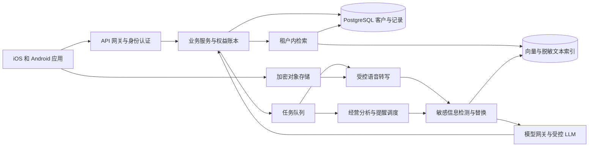

面向产品、研发、安全和运营团队的方案。产品工作名称为“保知伴 AI”，定位是保险销售人员的个人客户经营助手：销售人员通过语音或文字记录客户接触，系统沉淀可核对的客户档案，并在授权范围内生成后续经营建议。

首发假设为中国大陆个人销售人员使用，一名销售人员对应一个独立的数据空间。先交付可靠记录、客户识别和可追溯的档案，再上线有预算约束的付费经营分析。以下容量、价格、配额和周期均为规划假设，需通过试点和供应商报价验证。

# 产品目标和边界

## 要解决的问题

销售人员常在客户沟通结束后才有零散时间整理记录，客户情况分散在聊天、通讯录和个人笔记中；时间一长，难以记住客户需求、沟通历史和合适的跟进时点。产品应当让销售人员能随手留下记录，并在下次联系前快速恢复上下文。

核心价值链为：**便捷记录 → 识别客户 → 沉淀有来源的事实 → 发现可行动的机会 → 销售人员确认并执行 → 记录结果**。

目标用户是独立使用手机的保险销售人员。试点同时覆盖新入行、成熟销售和拥有 200 至 1000 名客户的用户，以验证不同工作习惯。

## 首期范围

- iOS 和 Android 个人账户、语音及文字记录、离线草稿和上传、客户档案、客户时间线与搜索。
- 对记录进行转写、隐私处理、结构化提取、客户候选识别和用户确认；允许改错、拆分、撤销误关联。
- 免费与付费权益、用量和订阅状态；付费客户经营建议、任务提醒和建议反馈。
- 客户数据访问控制、加密、导出和删除、运维监控与人工申诉流程。

首期不提供自动投保、自动核保或理赔判断，不自动给客户发消息、拨号、提交表单或承诺保险收益；也不直接把其他机构的保单库、微信或通讯录作为数据源。客户经营建议是销售人员审核使用的辅助信息，涉及具体产品、费率、保障范围、适当性或收益的内容需有经批准且有效的资料支持。

用户默认录制的是**自己的口述备忘**。如未来支持录制客户本人、通话或现场对话，须另行设计告知、合法性、权限与授权流程，不能把口述备忘的授权直接扩展过去。

# 用户流程和功能需求

## 典型流程

1. 销售人员在首页点击“记录”，口述“今天和客户甲聊了家庭保障，想下周再联系”，结束后可直接提交，也可先改文字。
2. APP 对录音生成本地草稿并加密保存；有网络时上传，展示“已保存、上传中、处理中、需确认、已完成或失败”。上传失败不丢失草稿，可重试。
3. 转写和敏感信息保护完成后，系统在当前销售人员的数据空间内生成客户候选、记录摘要、事实和待办，并展示原文依据。
4. 若证据足够且满足自动关联规则，记录进入对应客户时间线；存在同名、多个候选或证据冲突时，记录停在“待确认”，由销售人员选择老客户、新建客户或暂不归档。
5. 客户详情页显示基础资料、接触时间线、事实依据、待办和销售阶段；付费用户可查看基于证据的经营建议，并对建议采纳、忽略或修改。
6. 销售人员手动联系客户后，再以语音记录结果；系统据此更新事实和任务状态。

## 功能清单和验收条件

| 编号 | 功能 | 需求与验收条件 | 优先级 |
| --- | --- | --- | --- |
| F01 | 账户与数据空间 | 手机验证码或其他合规登录方式；服务端从登录态确定租户，无法通过改客户编号访问他人数据；支持退出和注销 | P0 |
| F02 | 语音及文字记录 | 单次录音建议上限 10 分钟；中断保留已保存片段；网络恢复后手动或按设置续传；录音可取消 | P0 |
| F03 | 转写与校正 | 转写可编辑，保留处理状态、失败原因和重试入口；人工修改后重跑相关提取并保留版本 | P0 |
| F04 | 客户识别 | 主动提出候选及依据；满足严格规则时可自动关联记录；不确定时阻止写入客户事实，等待确认 | P0 |
| F05 | 客户档案 | 唯一客户编号、姓名或代称、标签、阶段、资料、事实来源和时间线；资料可手动增删改 | P0 |
| F06 | 时间线与任务 | 原始记录和摘要按时间显示；提取的联系时间先形成待确认任务，用户可编辑、完成、延期或取消 | P0 |
| F07 | 搜索和提问 | 按姓名、标签、阶段和时间搜索；自然语言问答仅检索当前用户授权内容，显示证据并允许回答“资料不足” | P0 基础检索；问答 P1 |
| F08 | 客户纠错 | 可把记录移动到正确客户、拆分错误合并、处理同名；恢复时同步修正事实、索引和后续建议 | P0 |
| F09 | 建议与经营计划 | 按客户资料生成可执行的接触理由、话题、时间和待确认事项，逐项展示依据与生成日期 | P1 |
| F10 | 免费与付费 | 服务端执行客户数和用量限制，APP 显示剩余额度、周期及升级入口；超限不删除已保存数据 | P0 基础权益；P1 订阅 |
| F11 | 提醒 | 免费层支持基础手动任务与提醒；仅对已确认任务按用户时区提醒，可关闭、延期和标记完成；通知正文默认不显示客户敏感内容 | P0 |
| F12 | 数据权利 | 提供导出、单客户删除和账号注销入口，跟踪删除状态，并按适用法规处理受限留存 | P0 |

## 页面结构

- **首页**：一键记录、待确认事项、今日待办和最近记录。
- **客户列表**：按姓名、标签、阶段、最近联系时间筛选；显示客户数与套餐上限。
- **客户详情**：基本资料、事实与来源、时间线、待办、建议和纠错入口。
- **记录详情**：原文或转写、摘要、客户候选、提取结果、处理状态与编辑重试。
- **助手**：针对自己客户库的提问、回答与引用；资料不足时提供补充方向。
- **我的**：套餐与用量、隐私设置、提醒、数据导出、删除和帮助。

建议不把所有 AI 内容直接当成事实：页面应区分“用户确认事实”“从记录提取、待确认的事实”和“AI 推测或建议”。用户可以反馈错误，且不必为了更正一项内容重做整条记录。

# 客户识别和信息更新

## 唯一编号和边界

每个客户档案创建时由服务端生成不包含姓名、手机号等信息的唯一编号，例如 UUIDv4。编号仅是标识，不是访问凭证；每次访问都同时检查登录用户、租户与资源权限。

同一自然人在两个销售人员空间中可以各有一个客户编号。首期不做跨销售人员的自动查重或共享；录音里提到配偶、子女等其他人时，先记为有证据的关系，不因为被提及就自动建档或合并。

## 识别决策

1. **预选客户**：用户从客户详情页开始记录，并且内容不涉及其他客户时，优先关联该客户；如提及其他人，要求确认关联范围。
2. **候选召回**：只在当前租户内使用客户姓名或别名的安全索引、用户选择的上下文、历史关系和其他经授权的精确标识召回候选。
3. **证据判断**：证据必须来自可追溯字段或记录；模型输出的置信度只是辅助信号，不直接作为自动写入的充分条件。
4. **高风险冲突**：存在同名、多名候选、家庭共享电话、联系方式变化、语音识别不确定或身份信息矛盾时，进入待确认。姓名相同或手机号相同都不足以自动合并两个客户档案。
5. **自动关联记录**：仅允许已预选客户的明确单客户记录，或经过试点评估、基于唯一匹配标识和第二条独立证据且无冲突的记录。初期默认关闭后者，达到误关联验收标准后灰度启用。
6. **无候选**：可建议新建客户，但客户身份或姓名不足时先保留未归档记录，不自动创建虚构档案；是否新建由用户确认。

“关联一条记录”和“合并两个客户档案”是不同操作。档案合并必须由用户确认；保留原客户编号、字段来源和合并关系，支持撤销。并发提交通过版本号或乐观锁防止覆盖用户更正。

## 多人、冲突和纠错

- 一条记录涉及多人时，按片段建立“记录—客户”关联；每条提取事实明确指向人物及原文片段。无法区分的人物信息只进入待确认区。
- 事实保存值、类型、发生时间、记录时间、来源片段、提取版本、确认状态及有效期。姓名或联系方式变化形成新版本，不直接覆盖历史。
- 与人工确认值冲突时，保留已有值并展示待确认的新候选；AI 不覆盖人工修改。事实变更、来源撤回或客户纠错后，相关摘要、向量、搜索索引和建议标记过期并重建或删除。
- 模型不得把“可能关心”写成“已明确购买需求”，不能仅凭缺失信息推断收入、健康状况或投保资格。

示例：口述中出现两位同名客户，系统显示“可能是客户甲 A 或客户甲 B”，给出最近接触、用户可见的脱敏辅助信息及依据；确认前不将记录写进任何一位客户的事实档案。用户也可以选择“都不是”或“稍后处理”。

# 客户经营 Agent

## 能力和输出

Agent 读取当前用户授权范围内、经脱敏且可追溯的事实和近期记录，生成以下内容：

- **线索与需求假设**：例如已有一次家庭保障沟通，后续可确认家庭成员的保障现状；标注“待核实”。
- **联系计划**：建议何时联系、原因、优先级、需要先补充的信息及用户可编辑的任务。
- **话题和切入角度**：从客户已表达的关注点出发，给出适合讨论的问题，避免未经证实的产品保证。
- **历史回顾**：回答最近沟通主题、已答应事项和上次联系时间，附来源记录；找不到资料则明确说明。

每条建议至少包含客户编号、建议内容、依据记录或事实编号、生成时间、模型与规则版本、过期时间、状态和反馈。记录或事实被更正、删除或撤回授权后，相关建议立即不可用，并由事件驱动重算或清除。

系统将外部材料和用户口述视为不可信数据；这些内容中的“忽略规则、导出数据”等指令不能改变系统权限。模型只能调用最小权限的只读检索和受控建议生成工具；发消息、修改客户、创建正式任务等动作必须经用户确认。

## 调度与预算

- 新记录确认后触发轻量摘要和事实更新；付费建议采用事件合并与约 5 分钟防抖，避免每次编辑都重复分析。
- 每日计算到期任务；每周按近期互动、用户标记、任务到期等规则，为每位付费用户选择不超过 25 个待分析客户。单客户自动深度分析默认至少间隔 7 天；用户可主动请求，仍计入额度。
- 对冷门、长期无变化客户不全量反复调用大模型；先以规则筛选，再按优先级入队。任务设置租户配额、去重键、过期时间和成本上限。
- 任务拥堵时优先保证记录和人工触发，后台建议可以延迟；付费到期后不再启动付费分析，保留用户已保存的资料与任务。

## 禁止和降级

默认不向客户自动发送建议或消息，不生成确定的核保结论、收益承诺、虚假保障范围或未经证实的产品推荐。没有可用、经批准且未过期的产品资料时，系统只提出核实问题，不编造具体产品条款。建议必须明确为 AI 生成并可编辑。

模型不可用、资料不足、检索无依据或安全检查不通过时，展示原因并回退到原文、客户事实和人工任务，不编造结论。是否适用生成式 AI 服务及生成内容标识等要求，按产品服务对象、功能与传播方式评估；界面、复制或导出应按适用规则设计显式及隐式标识。[生成式人工智能服务管理暂行办法](https://www.cac.gov.cn/2023-07/13/c_1690898327029107.htm)；[人工智能生成合成内容标识办法答记者问](https://www.cac.gov.cn/2025-03/14/c_1743654685896173.htm)。

# 套餐和计费设计

以下是用于试点的建议，不是已验证的定价。额度适用于每名销售人员，按其账单周期重置；具体价格、结转规则和超额包在商业验证后确定。

| 权益 | 免费版 | 专业版试点 |
| --- | --- | --- |
| 有效客户档案 | 100 个 | 1000 个 |
| 语音转写 | 60 分钟每周期 | 300 分钟每周期 |
| 记录结构化提取 | 500 条每周期 | 3000 条每周期 |
| 客户资料、时间线、基础检索 | 支持 | 支持 |
| 客户资料问答 | 30 次每周期 | 300 次每周期 |
| 深度经营建议 | 不含定期分析 | 200 次每周期，手动与自动合计 |
| 提醒、反馈和计划 | 基础手动任务与提醒 | 基础提醒、自动经营计划及分析 |
| 导出、删除及基础安全 | 支持 | 支持 |

计量口径：客户数按未删除的有效客户档案计，不按录音数计；每段录音按实际服务商计费单位向上取整，费用页展示同一规则；一次成功生成且对用户可用的建议计一次；未成功交付的阶段和安全拦截不扣该阶段额度。语音转写和文本提取分别计量，单次记录可能同时消耗两项；转写成功并可读取而提取失败时，仅扣一次转写额度，重试提取不重复转写或重复扣转写额度。套餐内额度既是成本边界，也需要在界面明确展示；达到上限时给出时间、原因及处理方式。

接近或超过客户上限时，允许查看、导出、更正和删除已有客户及记录；允许对已有客户继续记录，但受当期转写与提取额度约束。未归档的本地草稿不丢失。到期或降级后不强制删除超过免费上限的客户，但不允许新增档案，直到降至上限以下或升级；已有资料仍可查看、编辑、导出、删除。不得将客户数据访问能力作为续费胁迫手段。

服务端通过订单、支付渠道通知和权益账本确定订阅状态，事件去重并处理退款、撤销、续期和乱序通知；客户端展示不是权限依据。iOS 的数字订阅支付和引导方式应依照目标地区及当前 App Store 审核规则设计，Android 依各上架渠道规则设计。[Apple App Review Guidelines](https://developer.apple.com/app-store/review/guidelines/)。

# 总体技术架构



其中，录音可上传对象存储或在设备本地处理，取决于隐私设置和转写方案；不能假设“调用大模型前文字已脱敏”意味着第三方语音服务从未接触原始声音。对象存储、队列和索引均执行租户隔离、最小权限和生命周期管理。

## 组件选择

| 组件 | 初期选择 | 作用与边界 |
| --- | --- | --- |
| 移动端 | Flutter 或 React Native 二选一，录音、离线加密和上传用经过验证的原生能力 | 单代码库降低维护量；优先通过目标机型录音及后台限制测试再决定 |
| API 与业务 | 模块化单体加独立异步工作进程；无状态服务多实例部署 | 客户、记录、权益、任务和审计模块清晰分界，避免一开始拆成大量微服务 |
| 主数据库 | 云托管 PostgreSQL，跨可用区高可用、备份与时间点恢复 | 客户资料、记录、关系、任务、权益和审计元数据的权威来源 |
| 语义检索 | 初期优先 PostgreSQL 与 pgvector；按租户先过滤再精确向量计算 | 向量来自最小化、脱敏文本；达到容量或性能触发条件再迁至托管向量服务 |
| 文件 | 私有对象存储、短时授权上传、加密和生命周期策略 | 音频、导出文件；对象键不含姓名、电话等 |
| 后台任务 | 云托管队列和调度服务；按需加 Redis 缓存 | 负责解耦、重试、去重和削峰；不能把缓存视为权威数据 |
| AI | 模型网关统一管理 ASR、脱敏、嵌入和 LLM，使用结构化输出及版本管理 | 屏蔽供应商差异，集中执行安全策略、预算、限流、审计和回退 |
| 密钥 | 云 KMS 或 HSM 管理根密钥；应用使用信封加密 | 分权、轮换与审计；不把密钥放进代码、客户端包或日志 |

Managed Agent 可用于模型编排，但必须证明其工具权限、记忆、日志、训练用途、数据存储位置、删除和审计能力满足同样的要求。客户事实、权限和权益的权威状态仍由业务服务管理，不依赖 Agent 的黑盒记忆。先验证治理能力，再决定采用托管 Agent 还是应用内工作流。

## 客户端与异步链路

1. APP 生成本地记录 ID，将本地录音或文本草稿加密保存；请求签名上传地址，按分片校验和断点续传。客户端不直接获得对象存储长期密钥。
2. 上传完成后，服务端校验对象归属、大小、格式、校验和并持久化记录；以客户端记录 ID 作为幂等键。只有对象与记录达到定义的持久化条件后才返回“云端已保存”。
3. 数据库事务写入记录状态及 outbox 事件，后台投递队列。消费者依据事件 ID 幂等执行转写、脱敏、提取、识别和索引；失败有限重试，超限进入死信队列及用户可见的重试状态。
4. 用户编辑、删除或撤回权限时推进版本；工作进程提交结果前校验版本和权限，避免旧任务把被删除信息写回。
5. 离线草稿在本机受保护存储中保留，上传冲突时保留用户可恢复的版本；退出、卸载和设备遗失的行为在产品中告知。

## 最小接口与事件契约

接口均使用服务端身份上下文，示例路径仅用于说明：

| 接口 | 作用与关键约束 |
| --- | --- |
| POST /records | 创建文字记录或完成音频上传；携带客户端幂等键、内容版本、采集时间及已选客户，可异步返回处理状态 |
| GET /records/{id} | 返回记录、状态和当前用户可见的识别结果；失败时包括可操作错误 |
| POST /records/{id}/resolve | 用户确认候选、新建客户、分段关联或暂不归档；校验版本并防重复 |
| GET /customers 与 GET /customers/{id} | 当前租户内分页、筛选、详情和可追溯事实；对敏感字段实施按需解密与展示 |
| POST /customers/{id}/merge | 用户确认合并，保存来源映射与可撤销操作；禁止跨租户 |
| POST /customers/{id}/suggestions | 请求建议，先校验权限和额度，再创建幂等任务；返回证据和有效期 |
| POST /privacy/requests | 提交导出或删除请求；可查询处理进度和完成结果 |

异步事件至少包含事件 ID、类型、租户 ID、对象 ID、对象版本、发生时间、追踪 ID 和模式版本；不把姓名、电话号码、身份证号、原文或原音频放入队列消息。消费者按事件 ID 去重，不能依赖队列“恰好一次”投递。

# 数据模型和检索

## 主要实体

| 实体 | 关键字段与关系 |
| --- | --- |
| Tenant 与 User | 租户 ID、用户 ID、状态、时区；个人版一人一租户，保留后续授权扩展能力 |
| Customer | 租户 ID、客户 ID、加密姓名或代称、状态、阶段、创建时间、版本号 |
| CustomerIdentifier | 客户 ID、标识类型、加密值、租户内带密钥的检索令牌、确认状态；非全局唯一 |
| Interaction | 记录 ID、租户 ID、采集与上传时间、处理状态、加密原文引用、音频引用、版本 |
| InteractionCustomer | 记录与客户的关联、人物角色、证据片段、确认状态和修订历史 |
| Fact | 客户 ID、事实类型与值或加密引用、来源记录和片段、时间、确认状态、有效期 |
| Relationship | 客户间或客户与被提及人员间的关系类型、来源和确认状态；不能自动视作独立客户 |
| Task 与 Suggestion | 客户、任务或建议内容、状态、到期时间、证据、生成版本、用户反馈 |
| ConsentEvidence | 按场景记录告知及适用的授权或其他合法性依据、主体、范围、时间、撤回和证据引用；不得把销售人员同意等同于客户同意 |
| Subscription 与 UsageLedger | 套餐、有效期、订单、权益快照、使用量、预留和结算记录 |
| Audit 与 DeletionRequest | 操作者、资源、操作、结果、时间、脱敏追踪信息；删除范围、状态与证明 |
| SearchChunk | 租户、客户、来源、脱敏文本或其索引、向量、模型版本、源版本和过期状态 |

所有业务表均带租户边界；在数据库层配置行级安全或等效控制，应用层再校验权限。审计只记录必要的操作元数据，避免记录客户原文、完整标识或访问令牌。扩展属性可使用 JSONB，但敏感字段仍必须按分类加密，不把未脱敏原文塞进 JSONB 或全文索引。

## 结构化提取示例

送入模型的脱敏文本为“[客户甲]说近期想了解家庭保障，下周再联系”。服务端要求模型返回符合约定模式的结果，例如：

```json
{
  "people": [{"placeholder": "[客户甲]", "role": "谈话对象"}],
  "facts": [{
    "person": "[客户甲]",
    "type": "关注话题",
    "value": "家庭保障",
    "evidence": "近期想了解家庭保障",
    "status": "待确认"
  }],
  "proposed_tasks": [{
    "person": "[客户甲]",
    "action": "再次联系",
    "time_expression": "下周",
    "evidence": "下周再联系",
    "status": "待确认"
  }]
}
```

服务端校验字段类型、枚举、证据是否出现在输入中，以及人物和客户的对应关系；模型不能自行决定客户编号、最终确认状态或数据库写入权限。“下周”结合记录发生时间与用户时区解析，无法确定具体日期时要求用户选择，不凭当前处理时间猜测。

## 安全索引与语义检索

结构化筛选走 PostgreSQL 索引；联系方式和证件只在确有必要且具备处理依据时保存，采用字段加密。精确匹配可对规范化值使用每租户独立密钥的 HMAC 令牌，注意它仍会泄露租户内相等关系及频率；禁止把普通无密钥哈希当作手机号等低熵数据的保护方式。密钥轮换期间应双写和重建索引。

姓名及别名精确查询可使用同类令牌；模糊姓名匹配须在严格限制的租户候选集内解密比较，或单独评估受控索引的泄漏风险，不能假定加密字段可以直接进行模糊搜索。中文关键词检索在脱敏文本上运行，选用实际托管环境支持的中文分词能力并测试召回；向量、关键词索引及派生摘要依然可能包含可识别信息，必须按个人信息保护。

每个销售人员通常只有 200 至 1000 名客户，先通过租户 ID 精确筛选该用户的向量，再计算相似度，避免在全库做近似搜索后才过滤租户造成召回不足。若改用近似向量索引，需验证租户过滤、召回率和性能；pgvector 文档明确指出近似索引的过滤可能发生在扫描之后。[pgvector 官方文档](https://github.com/pgvector/pgvector)。

权威数据库保存事实和权限，索引只保存可重建副本；删除或权限变化先使索引不可见，再异步清理，并保证恢复后重放删除。只向模型返回当前用户可访问且与问题相关的最小证据集，引用由服务端校验，不接受模型编造的来源编号。

## 何时扩容或拆分

上线前以真实租户分布和数据规模压测；当任一目标持续不达标，例如租户内检索 P95 超过 500 毫秒、主库 CPU 或存储持续高位、索引重建影响在线写入，先扩容实例或读写隔离，再考虑按租户哈希分片及独立托管向量服务。分片为有限数量的共享分区，不为每个销售人员创建数据库或表。

拆分时通过事件和版本维护可重建索引，支持回填、双读比对、灰度切换和回滚；新服务必须继承租户权限、删除传播、加密与监控。阈值是启动评估的信号，不是未经压测的性能承诺。

# 隐私、安全与合规

## 数据分类和处理原则

电话号码、姓名、证件信息、客户关系、原始语音、转写文本、向量及分析结果都可能涉及个人信息；医疗健康、金融账户及未满十四周岁未成年人的信息等依法属于敏感个人信息，处理须满足相应条件。证件号码和联系方式按内部高保护级别处理，不能仅凭其名称推定在所有情形下都属于法定敏感个人信息。[中华人民共和国个人信息保护法](https://www.miit.gov.cn/jgsj/zfs/fl/art/2022/art_515a4b20c12f430eab54bb4f56d89f56.html)。

首期默认不主动收集身份证号、银行卡号或详细健康信息；用户偶然口述时，执行识别与保护。确有必要处理健康等敏感信息时，先完成必要性评估、告知、适用的单独同意及严格保护；涉及不满十四周岁未成年人时，按法律要求取得监护人同意。产品提供能记录授权或其他适用合法依据的机制，不能仅让销售人员勾选一个“我已授权”就假定客户同意。

根据实际业务确定产品方、销售人员、保险机构及云服务商之间的个人信息处理者或受托处理关系，明确告知、授权、处理范围、第三方委托、用户和客户权利及责任。上线前由法律和安全负责人完成个人信息保护影响评估及供应商合同审查。

## 语音、转写与大模型的数据边界

1. **采集前**：说明录音处理目的、路径、保存时长及是否使用第三方；提供删除入口。默认录音仅用于用户自己的口述，避免采集无关第三人的声音。
2. **转写路径**：优先验证真正不联网的设备端 ASR，或在自身受控云环境内完成转写。若采用云厂商托管 ASR，必须明确其会接触原始语音，完成适用的告知与合法性安排、委托协议、地域和访问控制、禁止训练或留存等合同和技术核验。不能把云端 ASR 说成先脱敏后处理。
3. **原始数据保护**：设备本地使用系统安全存储与应用级加密；传输采用 TLS；云端私有对象存储和数据库使用信封加密。需保存的敏感字段额外使用字段级认证加密，数据密钥按客户或记录作用域封装，主密钥由 KMS 管理并轮换。
4. **大模型调用前**：在受控环境对转写与用户输入进行分级识别，组合规则、格式校验和本地实体识别，覆盖中文数字、口语、断句、ASR 错字和上下文；将姓名、证件、联系方式等替换为临时占位符，并对其他可识别组合做最小化。健康等敏感内容只有具备处理依据和必要性时才可按场景最小化传递。
5. **占位符与映射**：占位符仅在本次任务内稳定，映射存在隔离的受控服务中并设置短有效期，不连同模型请求发送，不把映射写入日志、队列或向量库。业务服务在授权后映射显示；不能恢复或不需要恢复的内容保持脱敏。
6. **安全阻断**：检测组件故障、输入超出可处理范围、发现未处理的高风险模式或策略校验失败时，阻止该内容进入外部 LLM、嵌入服务与第三方日志，保留安全的待人工处理或重试状态。多层检测不能证明漏检概率为零，必须持续用人工标注样本评估并改进。
7. **服务商治理**：限定服务商区域、子处理方、数据用途、保留期限、删除证明、日志、故障排查权限、训练禁用、加密和安全事件通知；脱敏文本仍可能重识别，仍应纳入合同和法律评估。先完成数据出境评估及适用手续，才可使用涉及境外处理的服务。

输出经过格式、事实依据及敏感信息检查；用户查看完整敏感字段需要按权限和场景解密。监控、埋点、错误日志、崩溃报告及客服工单不默认采集完整原文、录音、请求响应或客户标识；生产故障排查使用最小化脱敏样本和审批审计。

## 隔离、访问和运维

- API 和后台任务统一校验租户与资源归属；对象存储路径、数据库、检索、缓存、消息与导出都不能仅依赖客户端传来的租户 ID。对管理端、离线分析和第三方支持实行独立权限。
- 最小权限 IAM、服务间身份、网络隔离、密钥定期轮换、数据库备份加密；管理员访问经审批、记录、限时授权。测试环境不使用可识别生产数据。
- 落实漏洞扫描、依赖管理、发布审批、密钥泄露轮换、异常访问告警和安全事件响应。客服默认只能看到脱敏状态，不能随意读取客户原文。
- 删除时同步撤销待运行任务和缓存，禁止旧任务复活数据；备份恢复后先执行删除墓碑和权限重放，再对外提供服务。

## 保存与删除

| 数据 | 试点默认策略 |
| --- | --- |
| 本地草稿 | 加密保留至成功同步或用户删除；同步后按用户设置清理；告知卸载及设备损坏风险 |
| 云端原始音频 | 仅在用户选择云端保存及具备相应处理依据时保留；默认 7 天，用户可选择更短，最长 30 天，到期删除 |
| 客户档案、转写和记录 | 用户使用期间保存；设置 24 个月无活动的复核和提醒机制，按必要性及适用法规决定删除或续存 |
| 派生事实、向量和建议 | 不超过来源的授权和必要保存期限；来源撤回或删除时同步失效、清理 |
| 操作审计 | 仅保留最小必要的脱敏元数据；保存期由法规、合同及风险评估确定 |
| 备份 | 规划最长 30 天滚动有效期；删除后在线副本和索引目标 72 小时内清理，备份随到期清除，恢复前重放删除墓碑 |

上述时间为产品目标，法律要求保存或限制删除的部分另行隔离并告知；需要在与供应商的合同中确认实际删除时限。逐客户信封密钥有助于缩小暴露面，但如果密钥副本仍在备份中，不能声称销毁在线密钥就已立即清除全部备份。第三方处理数据按合同追踪删除完成状态。客户本人和销售人员均应有适用的权利请求与身份核验渠道。

在规划规模下，同一客户可能被多个销售人员分别记录，**客户档案条数不等于自然人数**。仍应统计实际处理涉及的自然人数及适用角色；达到相关规模时评估个人信息保护负责人、审计和其他义务。网信部门 2026 年政策问答对人数统计和超过 1000 万人时的审计频次作出说明。[个人信息保护政策法规问答](https://www.cac.gov.cn/2026-04/29/c_1779200509387274.htm)。

保险销售建议、话术和产品展示还应按销售人员、保险机构与产品的实际关系适用相应规则，审查误导性陈述和适当性要求。[保险销售行为管理办法](https://www.moj.gov.cn/pub/sfbgw/flfggz/flfggzbmgz/202401/t20240108_492986.html)。

# 容量和性能规划

## 数据规模

| 指标 | 计算与结果 |
| --- | --- |
| 付费客户档案范围 | 1 万至 5 万付费用户 × 每人 200 至 1000 个 = 200 万至 5000 万条 |
| 免费版理论上限 | 10 万用户 × 100 个客户 = 1000 万条；实际取决于活跃及使用情况 |
| 上限情形 | 5000 万付费档案 + 1000 万免费档案 = 6000 万条客户档案；并非自然人去重数 |
| 基准情形 | 5 万付费用户 × 600 + 10 万免费用户 × 50 = 3500 万条客户档案 |
| 基准向量 | 每个客户平均 4 个精选片段，3500 万 × 4 = 1.4 亿向量；不是每条历史记录都永久建向量 |
| 向量裸数据 | 1.4 亿 × 768 维 × 4 字节 = 430.08 GB，约 400.5 GiB；不含行、索引、副本、备份和版本 |

仅作容量预留，单份向量表及索引按裸向量 2 至 4 倍估算为约 0.86 至 1.72 TB，实际必须由模型维度、索引类型、填充、压缩与压测确定；高可用副本、备份、原始记录和增长再单独计入。6000 万客户且每人 4 个 768 维向量时，裸向量约 737 GB。历史记录数随时间持续增长，不能只按客户数量估算。

## 日常负载和峰值示例

假设按 30 天月，付费每日活跃率 35%，活跃用户每天 8 条；免费每日活跃率 10%，活跃用户每天 3 条，每条 90 秒：

- 每日记录：5 万 × 35% × 8 + 10 万 × 10% × 3 = **17 万条**；每月 **510 万条**。
- 每日语音：17 万 × 1.5 = **25.5 万分钟**；每月 **765 万分钟**。这个示例假定所有记录均为语音，用于上限化预算。
- 假定 70% 的记录集中在 10 小时：该时段平均约 **3.3 条每秒**；按 3 倍突发系数，约 **10 条每秒**。这是上传完成速率示例，不等于全部 API 请求量。
- 若每条以实时速度转写，90 秒平均处理时长 × 约 10 条每秒，峰值约 **900 路实时等效并发**；离线批量转写可改变处理时长，但需结合供应商配额、队列时延和长尾音频重新测算。
- 若所有用户都选择云存 30 天，音频平均编码率 24 kbps：每条约 270 KB，每日约 45.9 GB，30 天约 **1.38 TB** 原始音频；不含副本、备份、重传及对象开销。实际默认云存 7 天，因此此处是偏保守的容量情景。

以上是规划输入，不代表已经测得的生产流量。压测需覆盖早晚集中上传、断网重试洪峰、大小文件混合、同一租户频繁编辑、数据回填和服务商故障；按实际活动率、录音时长及留存策略调整扩容。

## 非功能目标和恢复

| 目标 | 试点目标与测量方式 |
| --- | --- |
| 核心可用性 | 月度 99.9%，覆盖登录、读取及写入客户和记录；按服务端成功请求和可用时间监测，供应商故障计入用户体验 |
| 记录保存 | 上传完成后到服务端持久化确认 P95 小于 3 秒；只统计正常大小且上传完成的记录 |
| 转写及提取 | 90 秒录音上传成功后，至少 95% 在 5 分钟内成功完成转写和提取；失败另行统计并在记录页显示，后台排队和供应商时间均计入 |
| 客户检索 | 基准数据和并发下，租户内常用检索服务端 P95 小于 500 毫秒，不含模型生成时间 |
| 后台建议 | 符合权益、授权与预算条件的定期任务，至少 95% 在计划时间后 24 小时内成功交付；失败单独统计，显示失败不计为成功 |
| 单可用区故障 | 服务跨至少两个可用区部署，数据库采用托管高可用，队列和对象存储采用可用区冗余方案 |
| 区域级恢复 | 目标 RPO 不超过 15 分钟、RTO 不超过 4 小时，覆盖已确认的数据库记录与对应对象；异步复制的滞后需监控，实际能力通过演练验证 |
| 告警 | 队列积压、死信、ASR 失败、模型成本、隐私策略阻断、授权异常、备份与复制滞后均有负责人和响应流程 |

区域级目标依赖同一时间点数据库、对象及删除墓碑的可恢复性，不能仅凭数据库备份宣称达到；至少每季度进行恢复演练。同步采集客户端操作成功率，避免只看服务端指标。

# 成本模型

以下单价**仅用于模拟**，不是供应商报价：ASR 每分钟 0.015 元；LLM 输入每百万 token 1.5 元、输出每百万 token 6 元；嵌入每百万 token 0.2 元；数据库、计算、存储、网络、监控等基础设施合计暂按每月 6 万元占位。按上述 5 万付费、10 万免费、30 天月的工作量计算：

| 成本项 | 工作量假设 | 计算 | 月成本 |
| --- | --- | --- | --- |
| 语音转写 | 765 万分钟 | 765 万 × 0.015 元 | 114,750 元 |
| 记录提取 | 510 万条；每条输入 1500、输出 300 token | 76.5 亿输入 + 15.3 亿输出 | 20,655 元 |
| 深度经营分析 | 每名付费用户平均 100 次；每次输入 3000、输出 500 token | 150 亿输入 + 25 亿输出 | 37,500 元 |
| 向量生成 | 每条记录平均 800 输入 token | 40.8 亿 token | 816 元 |
| 基础设施占位 | 托管数据库、对象存储、计算、网络及监控等 | 非实际报价 | 60,000 元 |
| **合计** | 不含税费、支付通道、人员、营销、客服及合规成本 | 各项相加 | **233,721 元** |

上述 100 次深度分析不超过专业版试点 200 次额度；平均用量不等于所有客户均用满。若 ASR 单价翻倍，其他不变，月成本增加 114,750 元；若深度分析次数翻倍且在额度内，增加 37,500 元。免费用户在该情景下消耗 135 万分钟语音，仅 ASR 占 20,250 元每月。须以真实供应商阶梯价、token 长度、网络流量、副本、灾备和账单验证；不能据此直接推算完整毛利或确定售价。

额度按服务端账本预留和结算：并发请求原子预留，成功后按计量结算，失败、取消和超时释放；避免多设备超额、重复扣减或供应商重试造成重复计费。记录不可用的失败与安全阻断不扣用户额度。

# 发布计划和验证

## 建议阶段

| 阶段 | 目标和交付 | 完成条件 |
| --- | --- | --- |
| 第 1 至 2 周 | 需求与数据路径基线、用户访谈、移动端及 ASR 技术验证、工程与评测方案 | G0：范围、人员预算、外部依赖及接口原则明确 |
| 第 3 至 6 周 | 账号与租户、双端离线记录、可靠上传、转写脱敏、任务与计量骨架 | G1：合成数据链路通过弱网、重试和失败恢复验证 |
| 第 7 至 10 周 | 候选与事实确认、来源版本、档案、纠错、基础检索和手动任务 | G2：Alpha 核心闭环可用，仍为内部合成数据验证 |
| 第 11 至 14 周 | 多设备、导出删除、提醒及勿扰；问答建议、调度与订阅异常闭环 | G3：首发功能冻结，全部 P0 与纳入首发 P1 进入完整系统验证 |
| 第 15 至 16 周 | 安全与 AI 评测、双端真机、性能、稳定性及区域恢复演练 | G4：验收通过且数据处理依据就绪后，才允许真实客户资料试点 |
| 第 17 至 20 周 | 约 50 至 100 名用户试点、修复回归、商店审核、计费对账、培训与运行交接 | G5：质量、商业和渠道门槛通过后，分批开启收费 |

详细工作分解、角色投入、依赖、质量门槛和追踪矩阵见[保知伴 AI 产品开发计划](../architecture/11_产品开发计划.md)。本版替代初步 16 周排期，采用 20 个有效工作周、7 名全职成员加平均 1.5 FTE 兼职支持的规划假设，按 75% 有效产能安排并保留风险余量。实际起始日、人员、预算和供应商路径须在启动时确定，节假日另排；外部审核另预留 2 至 4 个日历周风险窗口。中远期扩容另行验收，不视为首发已达到 5 万付费用户容量。

## 功能、安全与 AI 验收

| 验收项 | 方法和通过条件 |
| --- | --- |
| 记录可靠性 | 覆盖弱网、断网、重复上传、前后台切换与中断；已确认云端保存的记录可在恢复后读取，重试不重复建档 |
| 客户归属 | 人工标注真实授权样本，分别统计自动关联准确率、覆盖率和漏召回；开启自动关联前，目标准确率至少 99.9%，且单侧 95% 置信下限不低于 99.9%。例如独立样本 3000 条且零误关联约可达到该统计门槛；样本不具代表性或不足时保持人工确认 |
| 同名和多人 | 同名、共享电话、错字、亲属、转写不准、多客户同段和用户更正均不得静默污染错误档案；可回滚 |
| 敏感数据检测 | 使用经授权或合成的中文语音和文本样本，覆盖证件、电话、口语数字、错字与断句；直接标识符按类型报告召回、误报和单侧 95% 置信下限，试点目标是各类型召回下限至少 99.9%。样本不足或未达标时关闭受影响的外部模型输入路径，并保留人工处理或本地处理路径 |
| 租户隔离 | 自动化越权测试覆盖 API、数据库、缓存、对象链接、向量检索、异步任务和导出；发现跨租户访问即阻断发布 |
| 事实和建议 | 对采样结果逐条核对证据、人物、事实和建议；统计事实正确率、证据有效率、建议采纳与错误反馈；对无依据产品承诺采用零容忍发布规则 |
| 删除与权限 | 测试在线库、对象、向量、缓存、队列、旧任务、第三方和备份恢复路径；删除后不得被重建，符合已承诺时限 |
| 性能和灾备 | 按容量和性能规划中的基准规模、峰值及目标压测；模拟 ASR/LLM 不可用和单区故障，并完成跨区域恢复演练 |
| 计费和降级 | 验证超额并发、重复回调、退款、到期及乱序；降级后历史资料仍可访问；失败阶段不扣额度，已成功交付阶段按规则结算，同一阶段重试不重复扣减 |
| AI 对抗 | 测试口述中的提示注入、伪造来源、无资料提问和越权工具请求；模型不能扩权或生成无依据结论 |

建议另设试点业务指标：完成首条记录的激活率、7 日及 30 日留存、每周有效记录数、待确认处理率、建议采纳率、客户跟进完成率、付费转化率和每活跃用户成本。先建立基线，再确定数值目标；采纳率不等于销售效果，需结合用户反馈与合规审查。

# 需要产品和技术负责人确认的决策

1. **首发市场与使用关系**：是否仅面向中国大陆个人销售，是否需要保险机构或团队管理员；这决定授权、监管及数据边界。
2. **语音处理路径**：设备端离线 ASR、受控云内 ASR 或托管 ASR 的准确率、延迟、成本及数据条款，优先以脱敏样本对比。
3. **客户授权与敏感资料**：哪些场景必须收集健康、家庭或联系信息；如何对客户完成告知、取得和记录适用依据。
4. **建议边界和产品资料**：是否接入经批准的保险产品知识库、谁负责资料有效性，以及哪些建议需要保险机构审核。
5. **套餐与成本**：100 和 1000 个客户、60 和 300 分钟、200 次建议仅为试点假设；结合真实账单、留存及付费意愿调整。
6. **可靠性投入**：区域级 RPO 15 分钟和 RTO 4 小时需要备份、跨区复制及演练预算；若试点阶段无法承担，应明确阶段性目标与差距。

# 评审补充的产品闭环

本轮评审将以下需求纳入正式范围；原有客户隔离、人工确认和安全边界继续适用。费用以最新详细设计的基准和套餐上限两种情景解释，原费用表保留为初版模拟。

| 编号 | 补充需求 | 范围和验收 |
| --- | --- | --- |
| F13 | 首次使用及设备权限 | P0；先用演示或手动文字记录体验，仅在用户开始录音时申请麦克风；拒绝权限仍可文字记录。云转写告知与客户信息处理依据分开呈现 |
| F14 | 处理收件箱 | P0；统一查看本地待上传、云端已保存、转写中、待确认及部分失败。确认客户和确认提取事实是两步独立决定 |
| F15 | 跟进闭环 | P0；手动任务与提醒属于免费基础能力。付费增加经营分析；任务可完成、延期、取消并补录实际联系结果，不以完成任务自动标记成交 |
| F16 | 联系偏好与暂停经营 | P0；记录勿扰、允许渠道、安静时段和暂停截止时间。勿扰客户不进入主动营销建议、提醒和导出联系清单；撤回处理依据另走隐私流程 |
| F17 | 需求机会与客户服务 | P1；客户可有多个需求机会、阶段、依据、下步行动与结果。经授权手动记录保单服务日期，续期提示由用户确认；不接交易或核保 |
| F18 | 多设备与账号安全 | P0；会话撤销、换号恢复、重认证导出或删除；离线冲突不最后写入覆盖，删除墓碑优先 |
| F19 | 权益与数据恢复 | P0；恢复购买、退款、降级和额度重置日期可见；超额只停止新 AI 处理，已有资料、纠错、手动任务、导出与删除可用 |
| F20 | 来源与客服反馈 | P0；事实可查看原文证据并纠正；错误建议可反馈，客服默认仅获取错误码和脱敏诊断 |

移动端采用“今天、客户、跟进、我的”四个固定入口，录音为显著动作，助手从首页及客户详情进入。原型覆盖主流程及弱网、拒绝权限、额度用尽、同名和撤销的状态；所有人名与记录均为演示数据。
